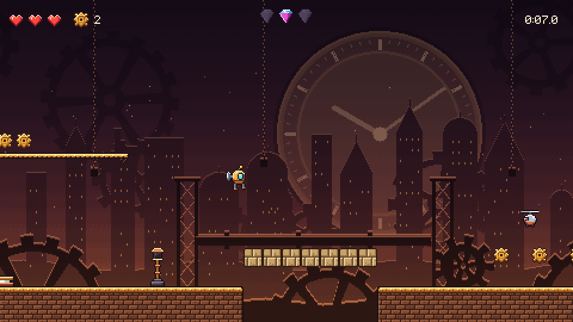

# Unity Platformer Lite: a free CodePlate template

> **Free CodePlate template, v1.1.0.** This repository mirrors the zip on [codeplate.io](https://codeplate.io/t/unity-platformer-lite/).
> Press **Use this template** to start your own repository from it, or [download the zip](https://codeplate.io/t/unity-platformer-lite/).
> [All templates](https://codeplate.io/) · [Free License](https://codeplate.io/license/free/) · subscribers get it under the [Pro License](https://codeplate.io/license/pro/) with no credit.

A pixel-art 2D platformer for **Unity 6** and C#, built so your AI agent can turn it into *your* game. It's the first world of CodePlate's [Unity Platformer](https://codeplate.io/t/unity-platformer/), complete and free.

## What's inside

- **Movement:** coyote time, jump buffering, variable jump height, apex hang, corner and ledge correction, and a **dash** that breaks walls. Double jump and wall jump are ready behind switches. Every number is in one JSON file, in tiles and seconds.
- **5 levels in the brass Gearworks**, with coins, 3 hidden gems per level, hearts and checkpoints, ending in a **boss** fight with a charging beetle.
- **Hazards and enemies:** spikes, pits, crumbling blocks, one-way ledges, springs, moving platforms, dash walls; walkers, flyers, spikers and turrets that shoot.
- **Screens:** title, world map, HUD, pause, results with best times, settings (volumes, screen shake, fullscreen, touch layout, reset) and credits. Progress is saved.
- **Hearts that matter and a level clock:** hits and falls cost a heart, running out restarts the level; levels can have a time limit with clock pickups. Every rule is a switch in the config.
- **Controls:** keyboard, gamepad, and **touch controls** (a one-surface d-pad, jump, dash) that appear on phones and tablets, sized and placed for every screen shape and kept clear of cutouts.
- **Ready to translate:** every text goes through one table (`strings.json`), English included; a recipe adds languages, and the checks list any text a language lacks or the font can't draw.
- **Look and sound:** original pixel art, a pixel font, parallax backgrounds, sound effects and music loops, all free to ship.
- **Builds** for the web (saves kept across reloads), Windows and macOS with one command each.

The full Unity Platformer adds a second world (the Steam Vaults: five more levels, its own tiles, backdrops and music) and a second boss, plus Google Play builds (a signed App Bundle, a test APK, an adaptive icon, a release guard) and an optional "watch an ad for an extra heart". Everything in this Lite works the same way there.

## For your agent

- **`AGENTS.md`**, a brief written for agents, with **16 step-by-step recipes**, from reskinning to adding a world or a boss.
- **One command to verify everything:** `npm run check` runs about 150 headless tests (movement against the config, collision, every enemy, the boss, hearts and the level clock, every level and its time limit, the touch layout on every screen shape, every text in every shipped language, the real game's menus, keyboard and touch input, saves) and the project rules.
- **A pure, deterministic simulation** in its own assembly (the compiler keeps Unity out of it), so every rule is testable without the editor.
- **Levels are plain-text ASCII maps**, with a **reach linter** (can the player get to every gem with the current jump?) and an **autopilot bot** that finishes every level, the boss included; its recorded runs are re-played on every check.
- **Screenshots of any moment** (`npm run shots -- level=3 x=40`), contact sheets for motion, and a feel report for the jump numbers.
- **One scene, built from code:** no prefabs or scene YAML for an agent to break.

## Use it with your agent

1. Unzip this folder where your project will live.
2. Install **Unity 6000.6.5f1** (Unity Hub, or `unity install 6000.6.5f1`) with a license activated (the free Personal license works), and Node 20 or newer.
3. Open the folder with your agent and say something like:

   > This is a platformer template. Read AGENTS.md, then let's make it my game: a cat climbing a giant cat tree, called "Whisker Heights". My sprites are in ~/art/cat (32 px). Make the jump a bit floatier.

## Play it yourself

Open the folder in Unity Hub with 6000.6.5f1, open `Assets/Scenes/Boot.unity`, and press Play. Or build it: `npm run build:web`.

Arrows or WASD move, Space or Z jumps, X or Shift dashes, Esc pauses. A gamepad works too.

## How this template was made

This template was written largely by AI coding agents (Claude, by Anthropic). IASoft reviewed and tested the work. The template's checks run on every change. To test it, a fresh agent was given a made-up project and a set of change requests to carry out with the template. The record of that run is at [codeplate.io/t/unity-platformer-lite/eval/](https://codeplate.io/t/unity-platformer-lite/eval/).

## License

You can use, modify and ship games made from this template, including commercially. Games you share must credit "Built with CodePlate (codeplate.io)": the game's Credits screen already shows it, so keep that line in `Assets/Resources/Content/credits.txt`. You can't resell the template itself. See [LICENSE.md](LICENSE.md). The placeholder assets are listed in `assets.json` and [CREDITS.md](CREDITS.md).

Made by [CodePlate](https://codeplate.io).
